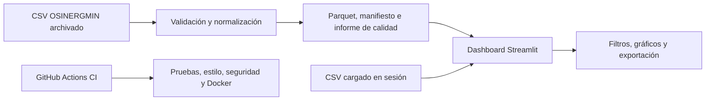

# FuelScope

**Explorador de precios de combustibles en Perú** — dashboard interactivo en Streamlit con un snapshot histórico de OSINERGMIN y carga opcional de otros archivos CSV.

> El snapshot incluido contiene precios reportados con fecha de observación entre enero y febrero de 2026. No representa precios actuales ni recomendaciones de compra. El diccionario entregado no documenta las unidades físicas y el CSV no contiene ubicación geográfica.

## Acceso al dashboard

**[Abrir FuelScope en Streamlit](https://fuelscope.streamlit.app/)**. También se puede ejecutar [localmente](#instalación-local) o con [Docker](#docker); todas las opciones muestran el snapshot histórico al abrirse.

## Funciones

- Cargar un CSV de hasta 50 MB y un millón de filas, con precios en formato largo o ancho.
- Asignar explícitamente las columnas de fecha, combustible, precio y territorio, y declarar una unidad para cada combustible.
- Filtrar las observaciones por periodo y combustible; por departamento solo si otro CSV incorpora esa columna.
- Cambiar entre apariencia clara y oscura desde la barra lateral; ambas usan la identidad visual roja de FuelScope.
- Explorar medianas, dispersión y tendencias con el número de observaciones visible. Los rankings territoriales requieren un archivo con departamento.
- Exportar los datos filtrados y un JSON con filtros, calidad y procedencia declarada.
- Generar localmente un snapshot Parquet versionado con manifiesto e informe de calidad verificables mediante SHA-256.

La carga interactiva dura solo durante la sesión. FuelScope no verifica automáticamente la procedencia del CSV que carga una persona usuaria.

## Fuente de datos e interpretación

La fuente es el [conjunto de precios de combustibles de OSINERGMIN en la Plataforma Nacional de Datos Abiertos](https://www.datosabiertos.gob.pe/dataset/lista-de-precios-de-combustibles-diaria-reconstruida-partir-de-los-precios-actualizados), publicado con licencia Open Data Commons Attribution License. La propietaria descargó el CSV, el diccionario y los metadatos desde el portal y los incorporó a este proyecto. El primer snapshot contiene **1 061 899 precios válidos** correspondientes al **1 de enero–28 de febrero de 2026**. El estado de la versión incluida se registra en [`data/source_status.json`](data/source_status.json). El catálogo indica publicación mensual. Consulta [fuente y licencia](docs/data_source.md) y [auditoría reproducible](docs/data_audit.md).

La aplicación excluye fechas inválidas, precios ausentes, cero o negativos. En este archivo solo se excluyeron celdas sin precio. Las comparaciones se hacen dentro de un solo combustible. El diccionario no indica la unidad física, por lo que el dashboard la marca como no documentada y evita comparaciones entre combustibles. Hay valores extremos conservados y documentados en la auditoría.

## Arquitectura



El snapshot se publica solo después de validar el CSV. Una actualización fallida conserva la versión previa. La [arquitectura detallada](docs/architecture.md) explica el contrato y sus límites.

## Tecnologías

Python 3.12 · Streamlit · Pandas · Plotly · PyArrow · pytest · Ruff · Docker · GitHub Actions.

## Instalación local

```bash
git clone https://github.com/Kiara1616/FuelScope.git
cd FuelScope
python -m venv .venv
```

Activa el entorno con `.\.venv\Scripts\Activate.ps1` en Windows PowerShell o `source .venv/bin/activate` en macOS y Linux. Después ejecuta:

```bash
python -m pip install -r requirements-dev.txt
streamlit run app.py
```

Abre <http://localhost:8501>. El snapshot histórico aparece por defecto; también puedes cargar otro CSV durante la sesión.

## Docker

```bash
docker compose up --build
```

Abre <http://localhost:8501>. La imagen incluye el snapshot histórico validado; la carga interactiva también está disponible en Docker.

## Ingesta manual y automatización

El contrato usado para el archivo incorporado está en `data/source_contract.json`. Para reconstruir el snapshot desde el CSV archivado, descomprime `data/raw/precios_combustibles_anonimizados_20260301_part1.csv.gz` sin alterar sus bytes y ejecuta:

```bash
python -m scripts.update_data --csv RUTA.csv --contract data/source_contract.json
```

El proceso guarda Parquet, manifiesto, informe de calidad y un puntero a la versión activa en `data/processed`. El mismo CSV y contrato devuelven `no_change`; un error mantiene el puntero anterior. La [tarea programada](.github/workflows/refresh-official.yml) consulta semanalmente la **URL directa de este recurso**, verifica que el diccionario y los metadatos no hayan cambiado, valida el esquema, la cobertura y el volumen, y solo entonces actualiza el snapshot. Su [primera ejecución manual en GitHub Actions](https://github.com/Kiara1616/FuelScope/actions/runs/39197140063) terminó correctamente sin cambios. Si la descarga falla o el portal publica un recurso con otra URL o estructura, conserva la versión anterior y requiere revisión. Esta tarea no consulta precios vigentes de Facilito.

El workflow de CI ejecuta Ruff, pytest, compilación de Python, auditoría de dependencias y una prueba de arranque con Docker en pushes y pull requests.

## Estructura del repositorio

```text
FuelScope/
├── app.py                    # Entrada de Streamlit
├── fuelscope/
│   ├── dashboard.py          # Interfaz y gráficos
│   ├── data.py               # Lectura, validación y métricas
│   └── snapshot.py           # Versionado e integridad
├── scripts/update_data.py    # Ingesta manual
├── data/raw/                 # CSV original comprimido, diccionario y metadatos
├── data/processed/           # Snapshot histórico Parquet y manifiesto
├── data/source_contract.json # Mapeo y URL del recurso
├── data/source_status.json   # Hash y cobertura de la versión incluida
├── tests/                    # Pruebas con datos sintéticos
├── docs/                     # Fuente, auditoría y arquitectura
├── .github/workflows/ci.yml  # Integración continua
├── Dockerfile
├── compose.yaml
└── README.md
```

## Reproducibilidad y pruebas

```bash
python -m pytest -q
ruff check .
ruff format --check .
python -m compileall -q app.py fuelscope scripts
```

Las pruebas usan filas sintéticas solo para verificar el procesamiento; no forman parte de los resultados del dashboard. El [informe de implementación](docs/implementation_report.md) registra las comprobaciones realizadas.

## Atribución y alcance

Fuente: **OSINERGMIN**, a través de la Plataforma Nacional de Datos Abiertos, bajo la licencia indicada en su catálogo. FuelScope es un análisis independiente y no implica aval de OSINERGMIN. La descarga directa actual coincidió byte por byte con los archivos entregados por la propietaria; el portal no publicó un checksum propio. El snapshot está auditado respecto a esos archivos, pero ninguna actualización programada garantiza precios vigentes.

La [versión histórica de ventas](https://github.com/Kiara1616/FuelScope/tree/v1-insightflow-sales) conserva el proyecto InsightFlow anterior.
