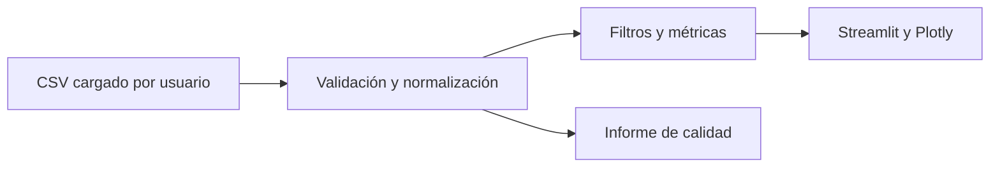

# FuelScope

Explorador de precios históricos de combustibles en Perú. **Estado actual: prototipo funcional con carga de CSV; aún no incluye un snapshot oficial auditado ni un despliegue público nuevo.** No presenta precios actuales ni recomendaciones de compra.

La migración parte del repositorio histórico InsightFlow, cuyo historial y artículo previo permanecen disponibles en Git. El nombre FuelScope responde a la instrucción del propietario.

## Fuente y limitaciones

La fuente prevista es el [conjunto de OSINERGMIN en la Plataforma Nacional de Datos Abiertos](https://www.datosabiertos.gob.pe/dataset/lista-de-precios-de-combustibles-diaria-reconstruida-partir-de-los-precios-actualizados), con licencia Open Data Commons Attribution License. El catálogo describe observaciones diarias y una frecuencia de publicación mensual. El servidor bloqueó la descarga del CSV y del diccionario desde este entorno. La aplicación no atribuye al archivo cargado una procedencia que no pueda verificar. Consulta [auditoría](docs/data_audit.md) y [fuente](docs/data_source.md).

Las columnas del CSV se asignan explícitamente en la interfaz. Se exige fecha observada, tipo de combustible, precio y una unidad declarada para cada tipo. Se descartan fechas inválidas, precios nulos, cero o negativos y unidades ausentes. El significado de cero queda pendiente de confirmar en el diccionario. Las medianas, percentiles y rankings siempre se calculan para un solo combustible y unidad; cada métrica indica recuento. La carga existe solo durante la sesión y no guarda el CSV en el servidor. El límite de carga es 50 MB y un millón de filas. La exportación ofrece un JSON complementario con filtros, calidad y procedencia declarada; la app indica que no verificó esa procedencia.

## Ejecución

Requiere Python 3.12:

```bash
python -m venv .venv
python -m pip install -r requirements-dev.txt
streamlit run app.py
```

Pruebas: `python -m pytest -q`; estilo: `ruff check .` y `ruff format --check .`. Docker: `docker compose build && docker compose up`.

## Arquitectura



La descarga automática, el manifiesto del snapshot, la auditoría de datos reales y el despliegue público requieren acceso verificable a los recursos originales. La antigua aplicación de ventas y el [artículo histórico](docs/insightflow-article-historical.md) describen la versión previa y no deben confundirse con FuelScope.
