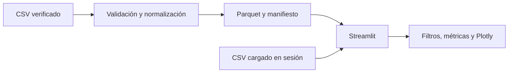

# FuelScope

Explorador de precios históricos de combustibles en Perú. **Estado actual: aplicación en el [PR de migración](https://github.com/Kiara1616/FuelScope/pull/1), sin snapshot oficial auditado ni despliegue público nuevo.** No presenta precios actuales ni recomendaciones de compra.

La migración parte del repositorio histórico InsightFlow, cuyo historial y artículo previo permanecen disponibles en Git. El nombre FuelScope responde a la instrucción del propietario.

## Fuente y limitaciones

La fuente prevista es el [conjunto de OSINERGMIN en la Plataforma Nacional de Datos Abiertos](https://www.datosabiertos.gob.pe/dataset/lista-de-precios-de-combustibles-diaria-reconstruida-partir-de-los-precios-actualizados), con licencia Open Data Commons Attribution License. El catálogo describe observaciones diarias y una frecuencia de publicación mensual. El servidor bloqueó la descarga del CSV y del diccionario desde este entorno. La aplicación no atribuye al archivo cargado una procedencia que no pueda verificar. Consulta [auditoría](docs/data_audit.md) y [fuente](docs/data_source.md).

Las columnas del CSV se asignan explícitamente en la interfaz. Se admiten archivos con una fila por precio o con una columna de precio por combustible. Se exige fecha observada, precio y una unidad declarada para cada tipo. Se descartan fechas inválidas, precios nulos, cero o negativos y unidades ausentes. El significado de cero queda pendiente de confirmar en el diccionario. Las medianas, percentiles y rankings siempre se calculan para un solo combustible y unidad; cada métrica indica recuento. La carga existe solo durante la sesión y no guarda el CSV en el servidor. El límite de carga es 50 MB y un millón de filas. La exportación ofrece un JSON complementario con filtros, calidad y procedencia declarada; la app indica que no verificó esa procedencia.

## Ejecución

Requiere Python 3.12:

```bash
python -m venv .venv
python -m pip install -r requirements-dev.txt
streamlit run app.py
```

Pruebas: `python -m pytest -q`; estilo: `ruff check .` y `ruff format --check .`. Docker: `docker compose build && docker compose up`.

## Ingesta manual preparada

`python -m scripts.update_data --csv RUTA.csv --contract contrato.json` publica un snapshot Parquet local solo si el CSV supera la validación. El contrato JSON debe proporcionar `mapping`, `units` por combustible, `source_url` y `license`. Para formato largo, `mapping` incluye `observed_date`, `fuel_type`, `price` y territorios opcionales. Para formato ancho, incluye fecha y territorios; `price_columns` enumera las columnas de precios a convertir en observaciones. **El contrato oficial aún no existe**: requiere leer el CSV y su diccionario originales. Un CSV idéntico con contrato idéntico devuelve `no_change`; un error conserva el puntero al snapshot anterior. Cada versión incluye SHA-256 del origen, SHA-256 de Parquet, recuentos y fechas de observación e ingesta. La fecha de descarga original se deja sin verificar. Consulta [arquitectura](docs/architecture.md).

El directorio `data/processed` está vacío en esta rama. Un snapshot real aprobado podrá versionarse e incorporarse en Docker tras la auditoría. La carga interactiva sigue disponible cuando no existe snapshot aprobado.

## Arquitectura



La descarga automática, la auditoría de datos reales y el despliegue público requieren acceso verificable a los recursos originales. El manifiesto y la ingesta manual ya están implementados, pero solo se han probado con fixtures sintéticos. La [versión histórica de ventas](https://github.com/Kiara1616/FuelScope/tree/v1-insightflow-sales) y su [artículo](docs/insightflow-article-historical.md) describen la etapa anterior.
