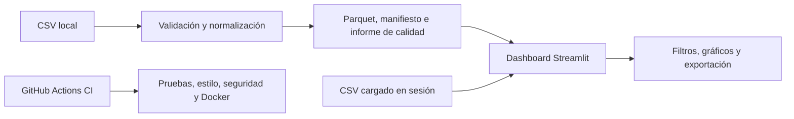

# FuelScope

**Explorador de precios de combustibles en Perú** — dashboard interactivo en Streamlit para analizar archivos CSV por fecha, combustible y territorio.

> FuelScope aún no incluye un conjunto oficial auditado. Los resultados de un archivo cargado describen únicamente ese archivo y no representan precios actuales ni recomendaciones de compra.

## Acceso al dashboard

La aplicación se puede ejecutar [localmente](#instalación-local) o con [Docker](#docker). **Aún no hay una demo pública nueva verificada de FuelScope.**

## Funciones

- Cargar un CSV de hasta 50 MB y un millón de filas, con precios en formato largo o ancho.
- Asignar explícitamente las columnas de fecha, combustible, precio y territorio, y declarar una unidad para cada combustible.
- Filtrar las observaciones por periodo, combustible y ubicación.
- Explorar medianas, dispersión, tendencias y rankings territoriales con el número de observaciones visible.
- Exportar los datos filtrados y un JSON con filtros, calidad y procedencia declarada.
- Generar localmente un snapshot Parquet versionado con manifiesto e informe de calidad verificables mediante SHA-256.

La carga interactiva dura solo durante la sesión. FuelScope no verifica automáticamente la procedencia del CSV que carga una persona usuaria.

## Fuente de datos e interpretación

La fuente prevista es el [conjunto de precios de combustibles de OSINERGMIN en la Plataforma Nacional de Datos Abiertos](https://www.datosabiertos.gob.pe/dataset/lista-de-precios-de-combustibles-diaria-reconstruida-partir-de-los-precios-actualizados), publicado con licencia Open Data Commons Attribution License. El catálogo describe observaciones diarias y publicación mensual. La descarga del CSV y su diccionario fue bloqueada desde este entorno, por lo que **el repositorio no contiene un snapshot oficial ni un contrato de columnas aprobado**. Consulta [fuente y licencia](docs/data_source.md) y [estado de la auditoría](docs/data_audit.md).

La aplicación excluye fechas inválidas, precios nulos, cero o negativos y unidades ausentes. El significado de los ceros queda pendiente de confirmar con el diccionario original. Las comparaciones de precios se hacen dentro de un solo combustible y una sola unidad; un valor obtenido de un CSV externo no debe interpretarse como estadística oficial verificada.

## Arquitectura



El snapshot se publica solo después de validar el CSV. Una actualización fallida conserva la versión previa. La [arquitectura detallada](docs/architecture.md) explica el contrato y sus límites.

## Tecnologías

Python 3.12 · Streamlit · Pandas · Plotly · PyArrow · pytest · Ruff · Docker · GitHub Actions.

## Instalación local

```bash
git clone https://github.com/Kiara1616/FuelScope.git
cd FuelScope
python -m venv .venv
```

Activa el entorno con `.\.venv\Scripts\Activate.ps1` en Windows PowerShell o `source .venv/bin/activate` en macOS y Linux. Después ejecuta:

```bash
python -m pip install -r requirements-dev.txt
streamlit run app.py
```

Abre <http://localhost:8501> y carga un CSV para explorar sus datos.

## Docker

```bash
docker compose up --build
```

Abre <http://localhost:8501>. La imagen no incluye datos oficiales; la carga interactiva también está disponible en Docker.

## Ingesta manual y automatización

Cuando se disponga del CSV y el diccionario originales por un canal autorizado, el operador debe comprobar las columnas, unidades, cobertura y licencia, y crear un contrato JSON con `mapping`, `units`, `source_url` y `license`. Para CSV ancho, añade `price_columns`. Después puede ejecutar:

```bash
python -m scripts.update_data --csv RUTA.csv --contract contrato.json
```

El proceso guarda Parquet, manifiesto, informe de calidad y un puntero a la versión activa en `data/processed`. El mismo CSV y contrato devuelven `no_change`; un error mantiene el puntero anterior. **La descarga y actualización automáticas de datos oficiales todavía no están implementadas**, porque falta auditar los archivos originales.

El workflow de CI ejecuta Ruff, pytest, compilación de Python, auditoría de dependencias y una prueba de arranque con Docker en pushes y pull requests.

## Estructura del repositorio

```text
FuelScope/
├── app.py                    # Entrada de Streamlit
├── fuelscope/
│   ├── dashboard.py          # Interfaz y gráficos
│   ├── data.py               # Lectura, validación y métricas
│   └── snapshot.py           # Versionado e integridad
├── scripts/update_data.py    # Ingesta manual
├── data/                     # Sin snapshot oficial incluido
├── tests/                    # Pruebas con datos sintéticos
├── docs/                     # Fuente, auditoría y arquitectura
├── .github/workflows/ci.yml  # Integración continua
├── Dockerfile
├── compose.yaml
└── README.md
```

## Reproducibilidad y pruebas

```bash
python -m pytest -q
ruff check .
ruff format --check .
python -m compileall -q app.py fuelscope scripts
```

Las pruebas usan filas sintéticas solo para verificar el procesamiento; no forman parte de los resultados del dashboard. El [informe de implementación](docs/implementation_report.md) registra las comprobaciones realizadas.

## Atribución y alcance

Fuente prevista: **OSINERGMIN**, a través de la Plataforma Nacional de Datos Abiertos, bajo la licencia indicada en su catálogo. FuelScope es un análisis independiente y no implica aval de OSINERGMIN. Antes de publicar cifras o una demo con datos, es necesario verificar el CSV y su diccionario, fijar el contrato de normalización y auditar el snapshot resultante.

La [versión histórica de ventas](https://github.com/Kiara1616/FuelScope/tree/v1-insightflow-sales) conserva el proyecto InsightFlow anterior.
