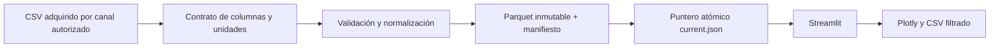
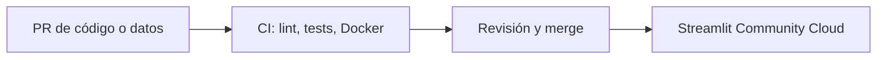

# Arquitectura de FuelScope

Se mantiene una aplicación Streamlit con módulos de transformación y métricas separados. No hay servicios adicionales. El procesamiento de un CSV local es explícito y no se ejecuta durante cada recarga de la interfaz.

El hash del origen y del contrato determina la versión. El pipeline crea los archivos de una versión antes de sustituir `current.json`. Si falla la validación o escritura, el puntero anterior permanece. La app comprueba el checksum de Parquet al cargar. La verificación de procedencia se hace fuera del programa y todavía está pendiente: el portal oficial bloqueó el acceso al CSV y al diccionario.

El flujo de datos programado, el merge y el despliegue nuevo no están activos. Los checks actuales cubren código y fixtures, no prueban un dataset oficial. La antigua aplicación pública de ventas sigue separada hasta poder verificar FuelScope con datos reales.
