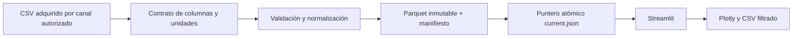
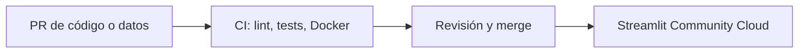

# Arquitectura de FuelScope

Se mantiene una aplicación Streamlit con módulos de transformación y métricas separados. No hay servicios adicionales. El procesamiento de un CSV local es explícito y no se ejecuta durante cada recarga de la interfaz.

El hash del origen y del contrato determina la versión. El pipeline crea los archivos de una versión antes de sustituir `current.json`. Si falla la validación o escritura, el puntero anterior permanece. La app comprueba los checksums de Parquet y del informe de calidad al cargar. El snapshot incluido proviene de los tres archivos que la propietaria descargó del portal; el contrato y la auditoría están versionados. El portal no ofrece un checksum independiente del CSV para corroborar su procedencia automáticamente.

La migración de código ya se fusionó. La tarea semanal de datos verifica la URL directa conocida y solo publica un cambio si pasa las validaciones; una ejecución manual en GitHub Actions confirmó la descarga y `no_change`. El despliegue nuevo no está activo. El CI cubre código, fixtures y arranque con el snapshot incluido. La antigua aplicación pública de ventas sigue separada de FuelScope.
